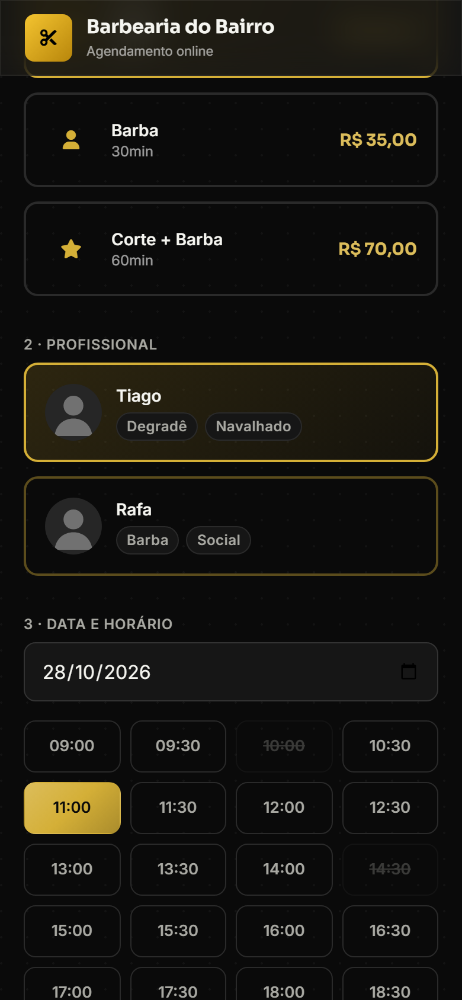
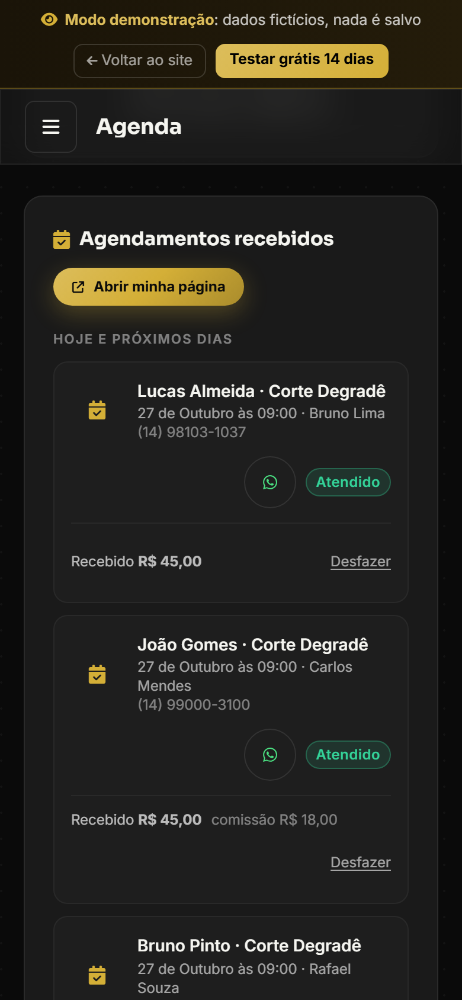
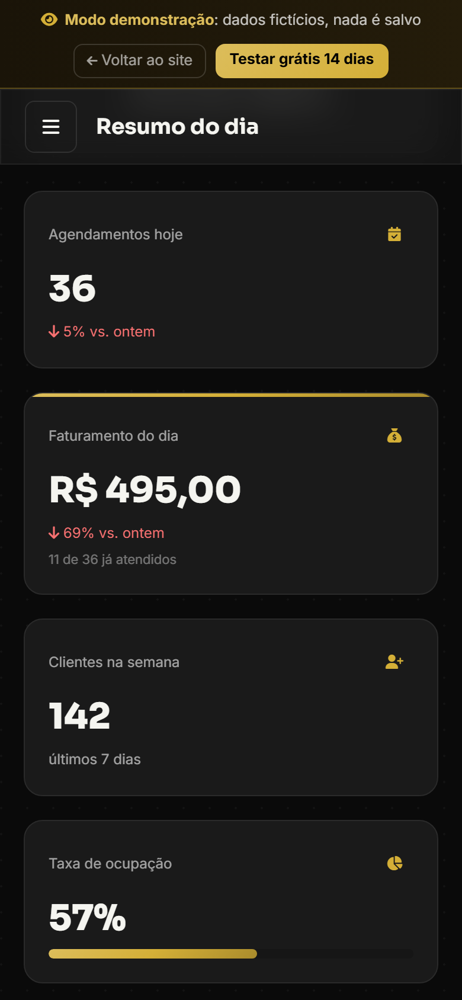
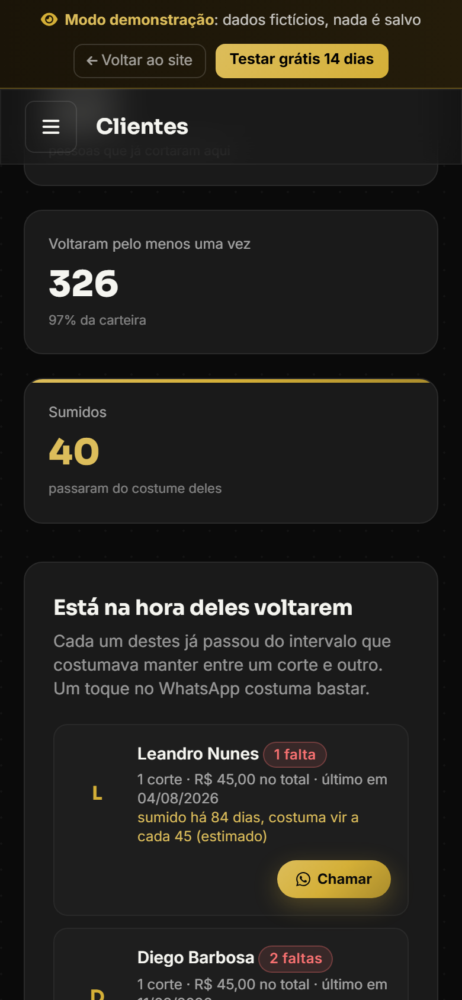

# BarberPro

**Agendamento online para barbearias.** O cliente marca sozinho pelo celular, sem baixar aplicativo e sem criar conta. O barbeiro acompanha o dia, a comissão e quem sumiu num painel só.

🌐 **Site:** [barberpro-cof.pages.dev](https://barberpro-cof.pages.dev)
🧪 **Painel de exemplo, sem cadastro:** [abrir a demonstração](https://barberpro-cof.pages.dev/painel/agenda?demo=1)

> Este repositório é a vitrine do produto. O código-fonte é privado.

---

## Como funciona

1. A barbearia ganha uma página de agendamento com o próprio nome: `barberpro-cof.pages.dev/b/nome-da-barbearia`.
2. O link vai na bio do Instagram, no WhatsApp ou num QR code impresso no balcão.
3. O cliente escolhe o serviço, o barbeiro e o horário. O agendamento cai na agenda na hora.

## Telas

| Página do cliente | Agenda do barbeiro |
|---|---|
|  |  |

| Resumo do dia | Clientes que sumiram |
|---|---|
|  |  |

Todas as telas usam dados de exemplo. Nomes, telefones e valores são inventados.

## O que já funciona

**Para o cliente da barbearia**
- Página de agendamento com o nome e a cor da barbearia, feita para o celular.
- Horário ocupado some da lista. A trava está no banco de dados, então dois clientes nunca ficam no mesmo horário, nem tocando no mesmo segundo.

**Para o barbeiro**
- **Agenda:** marca quem veio e quem faltou, e desmarca liberando o horário na hora.
- **Confirmação pelo WhatsApp em um toque:** o WhatsApp abre com a mensagem já escrita (nome, serviço, barbeiro, dia e hora). O envio é feito pelo barbeiro.
- **Resumo do dia:** agendamentos, quanto entrou de verdade e clientes da semana.
- **Fechamento:** quanto entrou, quanto vai para cada barbeiro de comissão e quanto fica na barbearia.
- **Clientes:** a carteira é da barbearia, com o último corte de cada um. Quem passou do próprio costume aparece separado, com o botão para chamar de volta no WhatsApp.
- **Barbeiros sem limite**, cada um com a própria agenda e horários de trabalho.
- **Meu link:** copiar, mandar no WhatsApp e gerar o QR code para imprimir.
- **Os dados são da barbearia:** dá para baixar tudo em planilha.

## Em desenvolvimento

- Lembrete automático no WhatsApp na véspera do horário, pela API oficial da Meta, só para quem aceitar receber.
- O próprio cliente desmarca ou muda o horário por um link, sem precisar ligar.

## Plano

**R$ 79,90 por mês**, um plano só, com tudo dentro. Teste de 14 dias grátis, sem cartão, sem fidelidade e sem multa para cancelar. No plano anual, 2 meses de desconto.

[Começar o teste grátis](https://barberpro-cof.pages.dev/painel/login?criar=1)

## Por dentro

| Parte | Tecnologia |
|---|---|
| Site e painel | HTML, CSS e JavaScript, sem framework. Tailwind compilado, sem CDN. |
| Banco e login | Supabase (Postgres com Row Level Security: cada barbearia só enxerga os próprios dados) |
| Hospedagem | Cloudflare Pages, com Pages Functions para a prévia do link no WhatsApp |
| Monitoramento | Cloudflare Worker com Durable Object: mede o site e o banco a cada 5 minutos, avisa por e-mail se cair e faz backup diário |
| Pagamento | Mercado Pago, assinatura mensal |

## Contato

- **Site:** [barberpro-cof.pages.dev](https://barberpro-cof.pages.dev)
- **WhatsApp:** [(14) 99172-1196](https://wa.me/5514991721196)
- **E-mail:** barberpro008@gmail.com

---

© 2026 BarberPro. Todos os direitos reservados. Veja [LICENSE](LICENSE).
